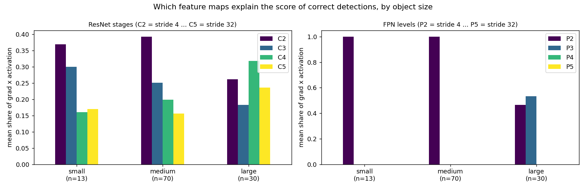
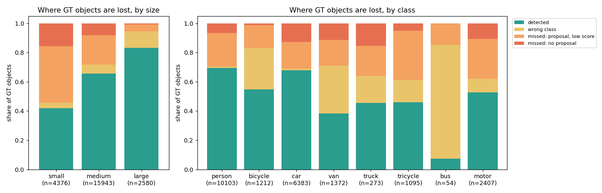
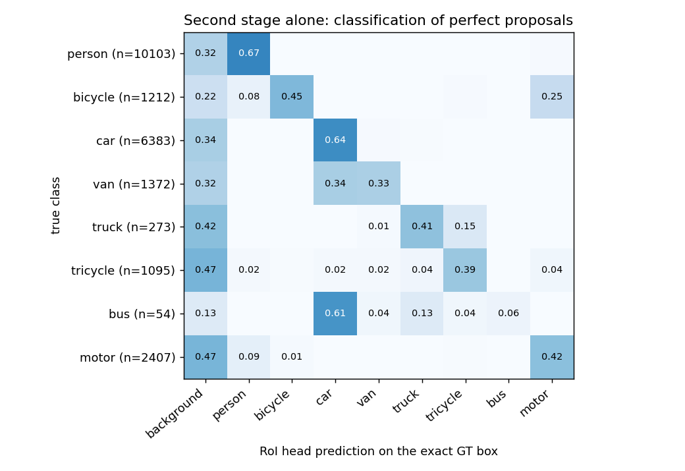
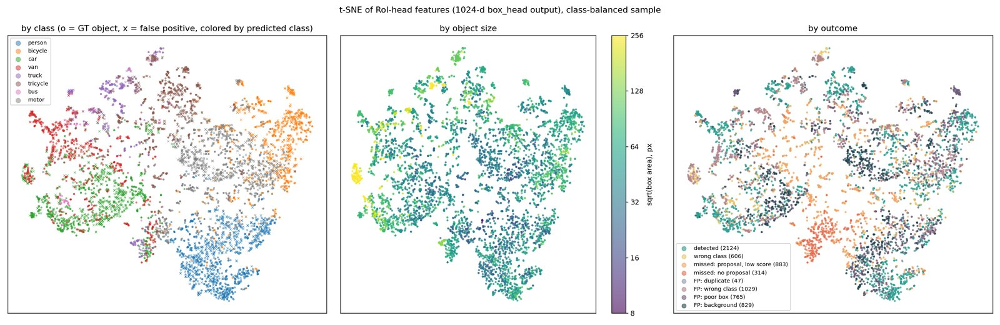
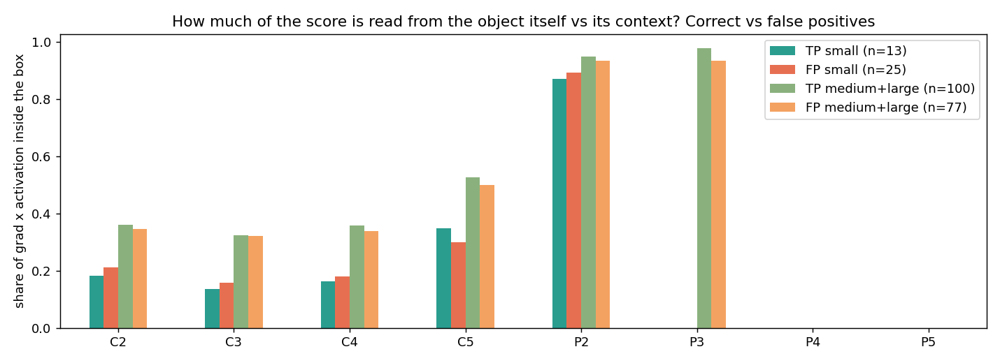
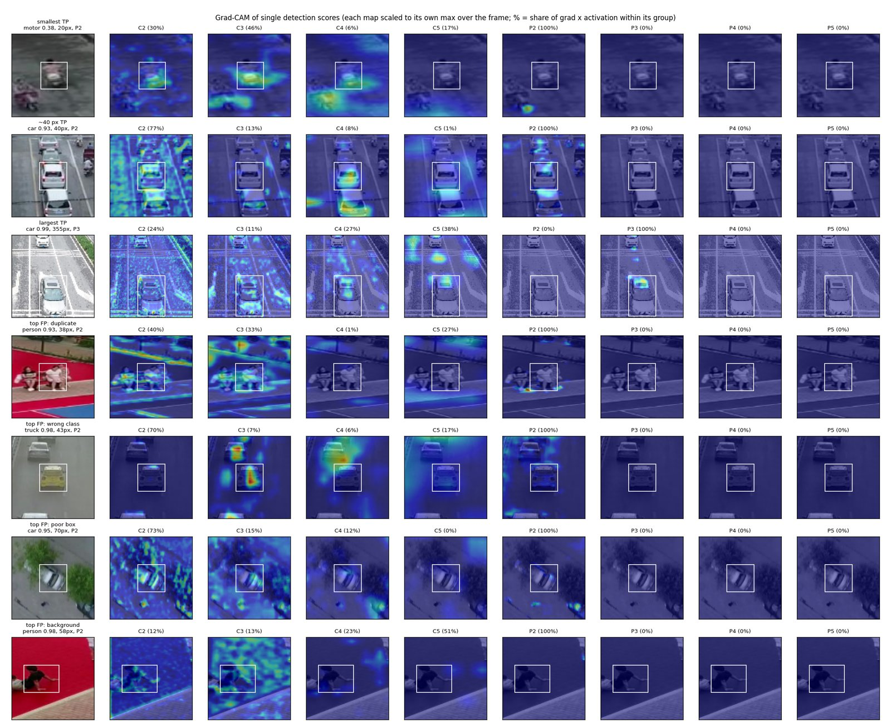

# Faster R-CNN: two-stage detector

The selected two-stage model is `base`, a COCO-pretrained Faster R-CNN (ResNet-50 FPN v2): mAP 0.2371, AP50 0.4870,
AP_small 0.0910, 549 ms per image on a T4. Its region proposal network finds 91% of the objects; most of the rest is
lost in the second stage.

**Code**: [`notebooks/02_faster_rcnn_experiments_kaggle.ipynb`](../notebooks/02_faster_rcnn_experiments_kaggle.ipynb)
is the notebook as it ran on Kaggle (code and outputs). The Kaggle run itself is described in
[`faster_rcnn_kaggle_run.md`](faster_rcnn_kaggle_run.md).

All runs train on every 5th train frame with one shared schedule and are evaluated on every 5th val frame. Each run
changes one parameter from the baseline (`--rpn-proposals 2000`, `--roi-pos-fraction 0.25`, `--box-loss smooth_l1`):

| Run | Change | Parameter | Cost |
|---|---|---|---|
| `base` | none | baseline | 1 training run (~2.6 h) |
| `giou` | `--box-loss giou` | box regression loss (stage 2) | 1 training run |
| `pos05` | `--roi-pos-fraction 0.5` | RoI sampling ratio (stage 2) | 1 training run |
| `base` @ 300 / 1000 proposals | test-time RPN proposals | number of RPN proposals (stage 1) | evaluation only |

Then `src.analysis.frcnn_explain` looks inside the `base` model: where each ground-truth object is lost (RPN vs RoI
head), a t-SNE of RoI features, and Grad-CAM over ResNet stages and FPN levels.

## Training setup and results

**Setup** (`src.models.faster_rcnn`, identical for every run): torchvision Faster R-CNN ResNet-50 FPN v2,
COCO-pretrained; input at native resolution (`min_size` 1080, `max_size` 1920: the 10–30 px objects do not
survive downscaling); one anchor size per FPN level P2–P6 (8, 16, 32, 64, 128 px) × aspect ratios 0.5 / 1 / 2;
SGD (momentum 0.9, weight decay 1e-4), lr 0.01, step decay ×0.1 after epochs 3 and 4, AMP, horizontal flip;
5 epochs on every 5th train frame (4,868 images), batch 4, one T4, ~154 min per run. RPN keeps 2000 proposals
after NMS (4000 before NMS in training); the RoI head samples 512 RoIs per image, 25% of them positive; score
threshold 0.01, at most 500 detections per image.

**Evaluation**: every 5th val frame (570 images), COCO AP with maxDets 500, ignored regions as `iscrowd`;
speed = full `evaluate` pass per image (batch 4, T4, pre- and post-processing included). The numbers come from the
`eval.txt` of each run and from the proposals sweep (`runs/frcnn_experiments.csv`).

| Run | Changed parameter | mAP | AP50 | AP75 | AP_small | AP_medium | AP_large | ms / image |
|---|---|---|---|---|---|---|---|---|
| `base` | none: Smooth L1, RoI positive fraction 0.25, 2000 proposals | **0.2371** | **0.4870** | 0.197 | 0.0910 | **0.225** | 0.422 | 548.7 |
| `giou` | box regression loss → GIoU (stage 2) | 0.2361 | 0.4825 | 0.198 | 0.0860 | 0.224 | 0.427 | 546.9 |
| `pos05` | RoI positive fraction → 0.5 (stage 2) | 0.2358 | 0.4813 | 0.198 | **0.1018** | 0.221 | **0.428** | 547.8 |
| `base` | 1000 RPN proposals at test time (stage 1) | **0.2371** | 0.4866 | 0.197 | 0.0909 | **0.225** | 0.422 | 483.6 |
| `base` | 300 RPN proposals at test time (stage 1) | 0.2335 | 0.4752 | 0.196 | 0.0899 | 0.221 | 0.418 | **440.8** |

Per class (`base`): car 0.424, person 0.278, van 0.262, truck 0.262, tricycle 0.249, bicycle 0.238,
motor 0.133, bus 0.051.

**Reading the parameters.**
- **Box loss.** GIoU does not beat Smooth L1 (−0.0010 mAP) and lowers AP_small (0.091 → 0.086). A
  plausible cause: for a box of a few pixels a one-pixel shift changes the IoU a lot, so an IoU-based loss is
  noisiest exactly on the small objects. It helps large objects a little (0.422 → 0.427) and bus (0.051 →
  0.102), but bus is the rarest class, so that change is within noise.
- **RoI sampling ratio.** Doubling the positive share of the 512 sampled RoIs leaves mAP unchanged (−0.0013)
  but gives the largest AP_small of all runs (0.091 → 0.102). Small objects are many but each overlaps few
  proposals, so they gain most from a larger share of positives in the head's training sample; medium objects
  lose a little (0.225 → 0.221).
- **Number of RPN proposals.** 1000 proposals give the same AP as 2000 and are 12% faster (484 vs 549 ms);
  300 lose 0.0036 mAP, mostly in AP50 (−0.012), because dense frames (up to 116 objects in a val frame)
  need several proposals per object.
- The three trained runs are within 0.0013 mAP of each other, less than a single seed can resolve, so `base`
  stays the selected model; for deployment, 1000 proposals are the better speed/accuracy point.

## What the region proposal stage and the second stage contribute

**Stage 1: the region proposal network (RPN)** answers *where something might be*, without a class. On every
FPN level a small convolutional head scores the 3 anchors at each position as object vs background and
regresses them; after NMS the top-scoring boxes (2000 here) become proposals. It turns ~0.5 M anchors per
1920×1080 frame (~173k positions on P2–P6 × 3) into a short list, and it is the only place where an object can be found at all:
an object without a proposal is lost for good.
- Its losses converge fast: at the end of `base`, `loss_objectness` 0.007 and `loss_rpn_box_reg` 0.031,
  against `loss_classifier` 0.153 and `loss_box_reg` 0.278 for the second stage.
- The proposal sweep measures what it contributes at test time: 300 → 1000 proposals raise mAP from 0.2335 to
  0.2371 and AP50 from 0.475 to 0.487; above 1000 nothing changes. With ≥ 1000 proposals the RPN no longer
  limits recall on these frames; most remaining errors are made after it.

**Stage 2: the RoI head** answers *what it is and exactly where*. For every proposal, RoIAlign cuts a 7×7
feature window from the FPN level that matches the proposal's size, two fully connected layers turn it into a
1024-d feature, and the head predicts one of 8 classes or background plus a class-specific box correction.
- It sees features aligned to the object instead of one grid cell, and it refines boxes that are already
  close, so localisation improves: AP75 is 0.197 here against 0.136 for the one-stage RetinaNet trained on the
  same frames for more epochs (notebook 04: 12 epochs vs 5).
- Its loss is computed on a balanced sample (512 RoIs per image, 25% positive), so the background imbalance
  that a one-stage detector handles with focal loss is solved by sampling; the RPN has already removed the
  easy background.
- 95% of all RoIs are pooled from P2 (P4 only 36 times among 22,899 objects): correct small and medium detections
  are explained entirely by P2, large ones split between P2 and P3; P4 and P5 play almost no role on this data.

- The two stage-2 parameters we changed (sampling ratio, box loss) move AP between object sizes but not the
  total, so on this data the head's capacity, not its loss setup, is the limit.

## Failure cases

`src.analysis.frcnn_explain objects` (every 5th val frame: 570 frames, 22,899 ground-truth objects) records for each
object the stage that lost it (no RPN proposal / proposal but score < 0.3 / wrong class), what the RoI head predicts
when given the exact ground-truth box, and a t-SNE of the 1024-d RoI features coloured by class, size and outcome.
`gradcam` (every 50th val frame, 2 true + 2 false positives per frame) computes Grad-CAM of single detection scores
on C2–C5 and P2–P5. It was run on the saved `frcnn_base/last.pt` after the Kaggle session, which had stopped before
this step. An object counts as detected when a box of its class with IoU ≥ 0.5 scores ≥ 0.3.

| Size | GT objects | RPN recall (IoU ≥ 0.5) | RoI head correct on the exact GT box | Final recall | FP per GT |
|---|---|---|---|---|---|
| small | 4,376 | 0.843 | **0.340** | 0.419 | 0.524 |
| medium | 15,943 | 0.917 | 0.618 | 0.657 | 0.275 |
| large | 2,580 | 0.992 | 0.805 | 0.831 | 0.231 |
| all | 22,899 | 0.911 | 0.586 | 0.631 | 0.318 |

### 1. A val clip at a resolution never seen in training

| Frame size (val) | Clip | GT objects | Recall | No proposal | Proposal, low score |
|---|---|---|---|---|---|
| 1344×756 | uav0000086, uav0000182 | 8,133 | 0.659 | 0.054 | 0.237 |
| 1904×1071 | uav0000305, uav0000339 | 3,691 | 0.621 | 0.045 | 0.235 |
| 2688×1512 | uav0000137 | 4,859 | 0.799 | 0.015 | 0.119 |
| 2720×1530 | uav0000117 | 3,486 | 0.618 | 0.086 | 0.237 |
| **3840×2160** | **uav0000268_05773_v** | 2,730 | **0.277** | **0.375** | 0.303 |

One clip, `uav0000268_05773_v`, is recorded in 4K; it holds 978 of the 2,846 val frames (34%), and no train
clip has this resolution (train: 1344×756 to 2720×1530). On it, recall falls to 0.28 and 37.5% of the objects
get **no proposal at all**, against 1.5–8.6% elsewhere. It is also why sparse frames fail most: the clip has
14 objects per frame, the others 40–103, so the sparsest quartile of frames (8–37 objects) has 18.5% of its
objects without a proposal and the denser quartiles only 4.7–5.7%.

*Plausible cause*: the model resizes every frame to a short side of 1080, so 4K frames are shrunk by 2 and
their objects to a quarter of their pixel area (median 2,340 px² in the original frame → ~585 px², ~24 px
across). COCO's size buckets use original pixels, so many "medium" objects of this clip are small for the
network; the 8 px anchors on P2 must then cover objects at a scale, viewpoint and altitude the RPN never saw.
*Fix*: keep 4K frames closer to native scale (tiled or sliced inference, or a larger `max_size`) and add scale
augmentation in training.

### 2. The second stage confuses similar vehicle classes

Handed the **exact** GT box, the RoI head labels 34% of vans as car (and only 33% as van), 61% of buses as
car, 25% of bicycles as motor and 15% of trucks as tricycle. These are the "wrong class" bars above: bus 78%,
van 33%, bicycle 28%, truck 19%. In the t-SNE of the 1024-d RoI features, van points sit inside the car
cluster and bicycle points run into the motor cluster: the head's features do not separate these classes.

*Plausible cause*: seen from above, a van, a bus and a car are all bright rectangles, and the height and side
profile that tell them apart are invisible; bicycle and motor are both a few pixels of rider plus wheels.
The classes are also very unequal (val: 6,383 cars, 1,372 vans, 54 buses), so an ambiguous vehicle gets the
frequent label. The Grad-CAM of the top wrong-class false positive (a "truck" at 0.98) reads its score from
a neighbouring car as much as from the box. *Fix*: class-balanced sampling or loss weights for the rare
vehicle classes, and more context or resolution for vehicles.

### 3. Small objects are found by the RPN but rejected by the RoI head

The RPN proposes 84% of the small objects, but given the exact GT box the head calls 62% of them background
(6% for large objects); 39% of small objects end as "proposal but low score". So for small objects the
second stage, not the proposal stage, is the bottleneck, which is also why more test-time proposals barely
change AP_small.

Grad-CAM points to why (a small sample: 13 small TPs, 25 small FPs). For correct small detections only 14–18%
of the C2–C4 evidence lies inside the box, against 32–36% for medium and large ones: the score of a small
object is read mostly from its surroundings. Small false positives look the same (16–21% inside the box), so the head cannot tell a 20 px object from a similar
patch of road. 95% of all RoIs are pooled from P2 (P4 only 36 times), so the whole decision rests on stride-4
features in which a 20 px object covers about 5×5 cells.

*Plausible cause*: RoIAlign stretches those few cells to a 7×7 grid, so the head sees an interpolated blob
whose appearance is dominated by context. *Fix*: higher input resolution or upsampled crops for small
objects; a larger share of positive RoIs already helps (`pos05`: AP_small 0.091 → 0.102).

### 4. Many false positives are boxes, not hallucinations

Of the 7,275 confident false positives, 35% are a correct object with a poor box (IoU < 0.5), 34% background,
28% wrong class and 2% duplicates. Most "background" FPs are labelled person (1,236). In the Grad-CAM gallery
the top background false positive (person, 0.98) is a clearly visible person on a red carpet, and the top
duplicate covers two people sitting side by side: some false positives are unannotated or merged objects, so
part of the FP count is label noise rather than model error.

## Conclusions

- **Best two-stage model**: `base` (Smooth L1, RoI positive fraction 0.25), mAP 0.2371, AP50 0.4870,
  AP_small 0.0910, 549 ms per image on a T4. It is the most accurate detector of the project so far
  (RetinaNet 0.147, YOLO11s-P2 at 1280 0.179) and the slowest (~10× YOLO): it runs at native 1080p
  resolution, and its second stage runs once per proposal.
- **Parameters**: neither stage-2 change improves mAP; a positive fraction of 0.5 trades medium-object AP
  for the best AP_small (0.102). Test-time proposals can drop from 2000 to 1000 for free (−12% time).
- **Where the stages fail**: the RPN finds 91% of all objects and saturates at ~1000 proposals; the RoI head
  then loses most of the rest (small objects scored as background, similar vehicles confused). The one
  exception is the unseen 4K clip, where the RPN itself misses 37.5% of objects; that clip alone holds a third
  of the val frames, so it costs much of the val mAP.
- **Limits**: one seed per setting; 5 epochs (the step decay ends the schedule early, and the training loss
  was still falling in epoch 5).
