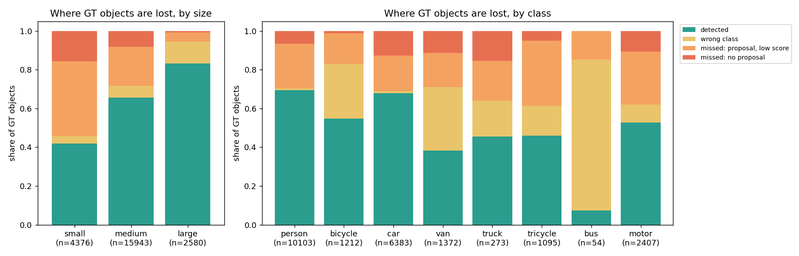
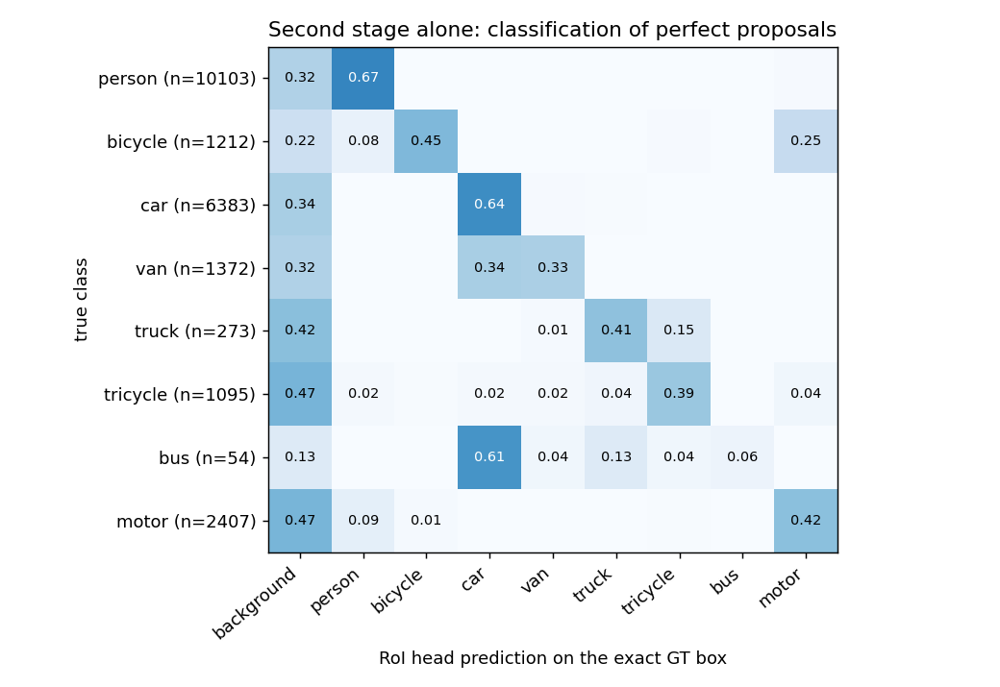

## 1. Methodology and motivation

### 1.1 Data analysis

All numbers are from [`notebooks/01_eda.ipynb`](notebooks/01_eda.ipynb) and
[`notebooks/data_temporality.ipynb`](notebooks/data_temporality.ipynb).

| Split | Clips | Frames | Resolutions |
|---|---|---|---|
| train | 56 | 24,201 | 6 (1344×756 to 2720×1530) |
| val | 7 | 2,846 | 5 (incl. one 3840×2160 clip) |
| test | 48 | 3,811 | 6 (680×382 to 1920×1080) |

- **The objects are small.** At a 640 px input, 69% of boxes have a side smaller than 16 px. Because of that, we used small anchors, raised the YOLO resolution, added a stride-4 P2 head, and implemented YOLO with tiles.
- **Small anchors are needed.** With default anchors (base 32 px), 92% of small boxes have no anchor with
  IoU more than 0.5; anchors from 16 px leave 19.6%.
  We used anchors 8–128 px for Faster R-CNN and from 16 px for RetinaNet.
- **Classes are very unequal.** Car has 505k train boxes, bus only 9.7k.
- **Consecutive frames are almost duplicates.** Same-track IoU is 0.85 at lag 1; with every 5th frame only 0.7% of
  tracks are never seen, so we trained on every 5th frame of each clip.
- **Ignored regions are common.** 72% of frames have at least one; they cover 2.3% of the frame.
  We handled them as `iscrowd` in evaluation (1.2).

### 1.2 Data preparation

We used these steps for every model in Section 2.

1. **Ignored regions.** The COCO annotations had many duplicate ignored regions. For example, one frame had 64 entries but only 8 unique boxes. We removed 446,901 duplicates from train and 27,965 from val. We also checked 20 frames from each split and confirmed that the COCO and YOLO boxes matched. Ignored regions were excluded from training, which used only the 8 object classes.
2. **Frame subsampling.** We kept every 5th frame from each clip, in frame
   order, so every clip stays represented: 4,868 train frames (of 24,201) and 571 val frames. 
3. **Model input processing.**
   - Faster R-CNN: YOLO boxes are converted to pixel `x1 y1 x2 y2` and clipped to the image; boxes with a side
     smaller than 1 px are dropped; labels are shifted by +1 (0 is the background); pixels are scaled to [0, 1]. Frames
     are resized to a short side of 1080 (long side <= 1920), close to native size. The only augmentation
     is a horizontal flip with probability 0.5.
   - RetinaNet: the same dataset class and flip, but resized to a short side of 640 (long side <= 1280).
   - YOLO11: Ultralytics letterboxes to `imgsz` (640 / 960 / 1280) and applies its default augmentation
     (mosaic, ±50% zoom, HSV, flip); mosaic is switched off for the last 10 epochs.
   - RT-DETR-L: Ultralytics pipeline at 640 px, every 5th frame.

We also tested splitting images into smaller 640 px tiles with 20% overlap. We covered ignored regions in gray, repeated tiles with rare classes, and used SAHI to combine predictions from the tiles.

### 1.3 Validation design

- **Split:** we validate on official val split.
- **Frames:** every 5th val frame (570 frames).
- **Metric:** one COCO evaluation for all models: pycocotools, mAP@[.5:.95], AP50, AP75, AP by object size
  (small < 32², medium < 96², large), maxDets 500, ignored regions as iscrowd. 
- **Temporal post-processing** needs consecutive frames, so it is evaluated on all frames. Its parameters were
  selected on development clips and the improvement is only on unseen clips.
- **One seed per setting** Differences smaller than 0.002 mAP are treated as noise.

### 1.4 Models

- **Two-stage, anchor-based: Faster R-CNN** ResNet-50 FPN v2 (torchvision, COCO-pretrained), anchors
  8/16/32/64/128 px on P2–P6 × ratios 0.5/1/2.
  The second stage re-examines each candidate on aligned features, which should help on small, crowded objects.
- **One-stage, anchor-based: RetinaNet** ResNet-50 FPN v2 (COCO-pretrained), we compared default and smaller anchors to evaluate the impact of anchor size in dense prediction with focal loss.
- **Anchor-free: YOLO11s** (Ultralytics, COCO-pretrained), tested at 640/960/1280 px with an optional P2 head to investigate the effects of input resolution and grid density.
- **Query-based: RT-DETR-L** (Ultralytics, COCO-pretrained), using set prediction with Hungarian matching instead of NMS.
- **Temporal:** We applied causal tracking and confidence rescoring to a frozen RetinaNet to use information from previous video frames.

### 1.5 Tuning strategy

Every experiment changes one parameter with everything else fixed:

- **Faster R-CNN** (5 epochs, every 5th frame, SGD lr 0.01, momentum 0.9, wd 1e-4, ×0.1 after epochs 3 and 4,
  batch 4, AMP): box loss Smooth L1 vs GIoU; RoI positive fraction 0.25 vs 0.5; RPN proposals at test time
  300 / 1000 / 2000.
- **RetinaNet** (12 epochs): default vs small anchors; focal α = 0.5; topk_candidates, NMS and score
  thresholds at inference.
- **YOLO11s** (12 epochs): input size 640 -> 960 -> 1280, then the P2 head at the best size and at 640.
- **RT-DETR-L** (8 epochs, AdamW lr 1e-5): 300 vs 200 queries; matcher costs (class/bbox/GIoU) 2/5/2 vs 2/7/3.
- **Temporal:** rescoring weight and propagation settings, selected on development clips.

## 2. Results and analysis

### 2.1 Benchmark

Every 5th val frame (570 frames), COCO AP with maxDets 500.

| Detector | Setting | Train frames / epochs | mAP | AP50 | AP_small | AP_medium | AP_large | ms / img |
|---|---|---|---|---|---|---|---|---|
| **Faster R-CNN** | `base` (Smooth L1, pos 0.25, 2000 proposals) | every 5th / 5 | **0.2371** | **0.4870** | **0.0910** | **0.225** | **0.422** | 548.7 |
| Faster R-CNN | initial run | every 20th / 6 | 0.1675 | 0.3611 | 0.0873 | 0.165 | 0.301 | 243.9* |
| YOLO11s | P2–P5 heads, 1280 | every 5th / 12 | 0.1791 | 0.3547 | 0.0769 | 0.166 | 0.314 | 57.4 |
| YOLO11s | initial, 640 | every 5th / 12 | 0.1239 | 0.2445 | 0.0613 | 0.116 | 0.247 | 37.7 |
| RetinaNet | small anchors | every 5th / 12 | 0.1459 | 0.3151 | 0.0608 | 0.136 | 0.278 | 140.2 |
| RetinaNet | default anchors | every 5th / 12 | 0.1468 | 0.2820 | 0.0423 | 0.134 | 0.310 | 126.6 |
| RT-DETR-L | 300 queries, matcher 2/7/3 | every 5th / 8 | 0.0189 | 0.0371 | 0.0093 | 0.019 | 0.044 | 86.3 |

The initial Faster R-CNN ran at a short side of 640, the tuned one at 1080.



### 2.2 Incremental improvements

| Step | Change | mAP | Δ |
|---|---|---|---|
| Faster R-CNN | 640 px, every 20th frame, 6 ep → 1080 px, every 5th frame, 5 ep | 0.1675 → 0.2371 | **+0.070** |
| YOLO11s | 640 → 960 | 0.1239 → 0.1594 | +0.036 |
| YOLO11s | 960 → 1280 | 0.1594 → 0.1709 | +0.012 |
| YOLO11s | + P2 head at 1280 | 0.1709 → 0.1791 | +0.008 |
| RetinaNet | `topk_candidates` 1000 → 2000 at inference | 0.1468 → 0.1569 | +0.010 |
| RetinaNet | small anchors | 0.1468 → 0.1459 (AP_small 0.042 -> 0.061) | 0.000 |
| RetinaNet + temporal | rescoring with past frames (held-out clips) | 0.1477 → 0.1505 | +0.003 |

The biggest improvements come from giving the network more pixels per object: native resolution for Faster R-CNN and
1280 px for YOLO. Changes to the loss or the anchors move AP between object sizes but almost do not change the total.

### 2.3 Feature experiments

**Faster R-CNN parameters** ([`docs/faster_rcnn.md`](docs/faster_rcnn.md)):

| Run | mAP | AP50 | AP75 | AP_small | AP_large | ms / img |
|---|---|---|---|---|---|---|
| `base` | **0.2371** | **0.4870** | 0.197 | 0.0910 | 0.422 | 548.7 |
| GIoU box loss | 0.2361 | 0.4825 | 0.198 | 0.0860 | 0.427 | 546.9 |
| RoI positive fraction 0.5 | 0.2358 | 0.4813 | 0.198 | **0.1018** | **0.428** | 547.8 |
| `base`, 1000 proposals | **0.2371** | 0.4866 | 0.197 | 0.0909 | 0.422 | 483.6 |
| `base`, 300 proposals | 0.2335 | 0.4752 | 0.196 | 0.0899 | 0.418 | 440.8 |

- GIoU does not help and lowers AP_small. For a small box of a few pixels, a one-pixel shift changes the IoU by a lot, so an
  IoU-based loss is noisiest on small objects.
- A positive fraction of 0.5 gives the best AP_small (+0.011) at the cost of medium objects, the total stays the same.
- 1000 proposals are as good as 2000 and 12% faster; 300 lose 0.004 mAP, because dense frames need several
  proposals per object.

**Where Faster R-CNN loses objects** (570 val frames, 22,899 objects; detected = right class, IoU ≥ 0.5, score ≥ 0.3):

| Size | RPN recall | RoI head correct on the exact GT box | Final recall |
|---|---|---|---|
| small | 0.843 | **0.340** | 0.419 |
| medium | 0.917 | 0.618 | 0.657 |
| large | 0.992 | 0.805 | 0.831 |

The RPN finds 91% of all objects, but many are lost in the second stage. Even when given the correct box, the model classifies 62% of small objects as background. Grad-CAM shows that only 14–18% of the information used to detect small objects comes from inside their boxes, meaning the model relies mostly on the surrounding area.

**YOLO grid points.** At 640 px, 11.3% of small objects have no stride-8 grid point inside of them, compared to only 0.9% at 1280 px. Adding a P2 head at 640 px solves this problem, but AP_small is still much lower (0.057 vs 0.082). This suggests that higher image resolution matters more for detecting small objects than adding more grid points.

### 2.4 Unsuccessful attempts

- **RT-DETR-L** performed poorly, reaching only 0.019 mAP, about eight times lower than RetinaNet. Its performance stopped improving after epoch 3. The version with 200 queries did not learn at all (mAP = 0), and we could not identify why. Even after 8 epochs, the results were low.
- **Faster R-CNN**: Changing the box loss to GIoU or increasing the positive sample fraction to 0.5 did not improve the mAP.
- **Small anchors in RetinaNet:** Detection of small objects improved (AP_small +0.019), and  AP50 too (+0.033). But, AP75 and AP_large decreased, so the overall mAP was almost the same.
- **P2 head in YOLO at 1280**  P2 head at 1280 px reduced AP_small from 0.082 to 0.077. This may be because only half of the pretrained COCO weights could be reused and the batch size was reduced from 8 to 4. The model was still improving at epoch 12.
- **Temporal post-processing** The improvement was small (+0.003 mAP), although it helped on all 5 held-out clips (+0.0025 to +0.0055). The effect was larger in crowded frames (+0.005 mAP).

### 2.5 Failure cases

1. **An unseen 4K clip.** The val clip `uav0000268_05773_v` is 3840×2160, a resolution that no train clip has,
   and it holds 34% of val frames. Faster R-CNN shrinks it by 2 to fit a short side of 1080: recall drops to
   0.28 and 37.5% of objects get no proposal (1.5–8.6% on the other clips). This clip alone pulls the val mAP down.
2. **Similar vehicles.** Given the exact box, the RoI head labels 61% of buses and 34% of vans as car, and 25%
   of bicycles as motor. From above these classes look alike, and the frequent class wins. Bus AP is 0.05.
3. **Small objects scored as background** (see 2.3).
4. **Many false positives are imprecise boxes or missing labels:** of 7,275 confident false positives, 35% are a
   real object with IoU < 0.5, 34% background, 28% wrong class. Some "background" persons are clearly visible
   but unannotated people.



### 2.6 Conclusions

- **Resolution matters most.** Native-resolution input added +0.070 mAP to Faster R-CNN, and 640 → 1280 added
  +0.047 to YOLO11s. Loss and anchor changes stayed within 0.002.
- **The two-stage detector is the most accurate** (0.237 mAP, 0.091 AP_small) but ~10× slower than YOLO11s-P2
  (0.179). Anchor-free YOLO beats anchor-based RetinaNet on every object size and is 2.4 faster.
- **The bottleneck is classification of small objects,** not finding them: the RPN proposes 84% of small objects,
  but the head keeps only about a third.
- **Query-based RT-DETR did not work** under our training budget.
- **Temporal context helps a little** (+0.003 mAP) and consistently.
- **Limits:** one seed per setting; unequal epochs across families (5 for Faster R-CNN, 8 for RT-DETR, 12 for
  YOLO and RetinaNet).

## 3. Final model and run instructions

**Our pipeline: YOLO11m at 1280 px + temporal post-processing**
([`notebooks/08_temporal_yolo.ipynb`](notebooks/08_temporal_yolo.ipynb)).

The selected model we implemented is **YOLO11m with temporal post-processing**, which showed the best public scrore (0.27).

Run of yolo11s-960: https://forge.coreweave.com/wandb/svyrydenkoiryna972-ukrainian-catholic-university/drone-multi-object-detection/runs/2xqwqm4h?nw=nwusersvyrydenkoiryna972

Run of yolo11s-960-cm2: https://forge.coreweave.com/wandb/svyrydenkoiryna972-ukrainian-catholic-university/drone-multi-object-detection/runs/dghvmbw1?nw=nwusersvyrydenkoiryna972

Run of yolo11m-1280: https://forge.coreweave.com/wandb/svyrydenkoiryna972-ukrainian-catholic-university/drone-multi-object-detection/runs/66u5gfse?nw=nwusersvyrydenkoiryna972

Run of yolo11m_1280_temporal: https://forge.coreweave.com/wandb/svyrydenkoiryna972-ukrainian-catholic-university/drone-multi-object-detection/runs/v8y0ypkk?nw=nwusersvyrydenkoiryna972


**Dependencies.** Python 3.12+, CUDA PyTorch, ultralytics==8.4.208, pycocotools, opencv-python
(ORB features), numpy, pandas, scipy (for Hungarian matching); wandb. All requirements are in
[`requirements.txt`](requirements.txt). Run on Kaggle or Colab with GPU.

**Settings.**

| Setting | Value |
|---|---|
| Model | yolo11m.pt (COCO-pretrained), heads P3–P5 |
| Training frames | every 5th frame of each clip; the submission model uses **train + val** |
| Input size | 1280 |
| Epochs, batch | 6, 4 (Ultralytics accumulates gradients to a nominal batch of 64) |
| Augmentation | Ultralytics defaults + mixup 0.1, copy_paste 0.1, scale 0.7; mosaic in epochs 1–2 only (--close-mosaic 4) |
| Optimizer, schedule | Ultralytics defaults (optimizer=auto, linear LR decay, warm-up) |
| Weights used | last.pt (final epoch) |
| Inference | imgsz 1280, confidence >= 0.01, at most 500 boxes per frame |
| Temporal | iou 0.5, ema 0.7, new_track 0.3, propagate 0.5, decay 0.8; weight, max_age and motion as selected on the 4 tuning clips |
| Seed | Ultralytics defaults: seed=0, deterministic=True |


**How to run the final model**:

```bash
pip install -r requirements.txt

python -m src.data.get_data --output-dir data
python -m src.data.make_subset --data-root data --output-dir visdrone-subset --step 5 --splits train val

python -m src.models.yolo_baseline train --data-root visdrone-subset --model yolo11m.pt --epochs 6 --imgsz 1280 \
    --batch 4 --close-mosaic 4 --mixup 0.1 --copy-paste 0.1 --scale 0.7 --project runs --name yolo11m_1280_e6_aug
python -m src.models.yolo_baseline evaluate --weights runs/yolo11m_1280_e6_aug/weights/last.pt \
    --split-root data/val --step 5 --imgsz 1280

python -m src.analysis.temporal index --split-root data/val --out val_index
python -m src.models.yolo_baseline predict --weights runs/yolo11m_1280_e6_aug/weights/last.pt \
    --test-root val_index --out val_all_frames.csv --imgsz 1280 --conf 0.01 --batch 8
python -m src.analysis.temporal evaluate --pred val_all_frames.csv --images-csv val_index/test_images.csv \
    --split-root data/val --weight <W> --max-age <A> [--motion]

python -m src.models.yolo_baseline train --data-root visdrone-subset --model yolo11m.pt --epochs 6 --imgsz 1280 \
    --batch 4 --close-mosaic 4 --mixup 0.1 --copy-paste 0.1 --scale 0.7 --project runs \
    --name yolo11m_1280_e6_aug_trainval --train-val

python -m src.models.yolo_baseline predict --weights runs/yolo11m_1280_e6_aug_trainval/weights/last.pt \
    --test-root data --out submission_raw.csv --imgsz 1280 --conf 0.01 --batch 8
python -m src.analysis.temporal apply --pred submission_raw.csv --images-csv data/test_images.csv \
    --out submission_temporal.csv --weight <W> --max-age <A> [--motion]
```
